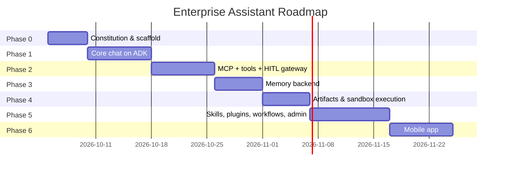

# Constitution: Living Execution Roadmap

## Phase 0: Foundations & Constitution
- [x] Establish `mission.md` and define project boundaries.
- [x] Establish `techstack.md` and verify base dependencies.
- [ ] Scaffold monorepo (`pnpm workspaces` + `Turborepo`), CI pipelines, remote caching.

## Phase 1: Core Foundation — chat on ADK (MVP)
*Target Spec*: `specs/spec-01-core-foundation.md`
- [ ] Task 1.1: SSO/OIDC auth end to end (web client → `api` → IdP).
- [ ] Task 1.2: `agent-runtime` stood up with a single `LlmAgent`, `DatabaseSessionService` on Postgres, `InMemoryMemoryService` placeholder.
- [ ] Task 1.3: Streaming chat (SSE) from web client through `api` to `agent-runtime` and back.

## Phase 2: MCP Tools & Human-in-the-Loop
*Target Spec*: `specs/spec-02-mcp-tools-hitl.md`
- [ ] Task 2.1: `McpToolset` wired to 2–3 high-value MCP servers.
- [ ] Task 2.2: Permissions/audit layer (`tool_invocations`) in front of the toolset.
- [ ] Task 2.3: Custom `pending_approvals`-backed HITL gateway for critical/write actions.

## Phase 3: Memory
*Target Spec*: `specs/spec-03-memory.md`
- [ ] Task 3.1: Custom `BaseMemoryService` on Postgres + `pgvector`.
- [ ] Task 3.2: `after_agent` write callback + `before_model`/`preload_memory` retrieval path.
- [ ] Task 3.3: "What does it remember about me" panel in the web client.

## Phase 4: Artifacts & Code Execution
*Target Spec*: `specs/spec-04-artifacts-execution.md`
- [ ] Task 4.1: Sandbox vendor (E2B) wired in as an ADK `FunctionTool`.
- [ ] Task 4.2: ADK Artifact Service backed by object storage.
- [ ] Task 4.3: Sandboxed rendering surface (isolated-origin iframe / in-app WebView).

## Phase 5: Skills, Plugins, Workflow Patterns & Admin Console
*Target Spec*: `specs/spec-05-skills-plugins-admin.md`
- [ ] Task 5.1: Skill router (`before_model` callback) over versioned `skills/` content.
- [ ] Task 5.2: Org-wide ADK Plugin for audit/cost tracking and redaction.
- [ ] Task 5.3: Coordinator sub-agent pattern for the first graduated skill; graph-based workflow for any skill needing branching + human-input nodes.
- [ ] Task 5.4: Admin console — users, roles, tool connections, skill catalog, HITL approval queue, usage dashboards.

## Phase 6: Native Mobile App
*Target Spec*: `specs/spec-06-mobile.md`
- [ ] Task 6.1: React Native (Expo) app against the now-stable `api` contract.
- [ ] Task 6.2: OIDC + PKCE auth, secure token storage, biometric unlock.
- [ ] Task 6.3: Offline cache, push notifications, sandboxed Artifact rendering in-app.
