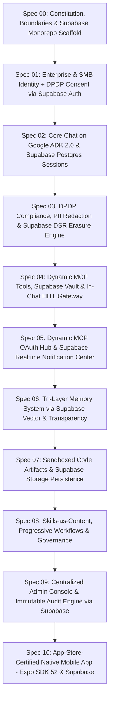

# Workkbot 2.0: Architecture & 10-Feature Specification Roadmap
## Sized for Indian SMBs (<100 Seats) on Supabase with DPDP Compliance & App Store Approval Guarantee

---

### Project Constitution (Spec-Driven Development)
Per the [spec-driven-development](file:///Users/sagarmeisheri/.gemini/config/skills/spec-driven-development/SKILL.md) framework, the project constitution defines the non-negotiables, technical blueprint, and living roadmap:
- **[constitution/mission.md](file:///Users/sagarmeisheri/Apps/workkbot/gemini-specs/constitution/mission.md)**: Vision, personas, product scope, and non-negotiable operational boundaries.
- **[constitution/techstack.md](file:///Users/sagarmeisheri/Apps/workkbot/gemini-specs/constitution/techstack.md)**: Single FastAPI backend, modern dependencies, and Supabase unified platform rules.
- **[constitution/roadmap.md](file:///Users/sagarmeisheri/Apps/workkbot/gemini-specs/constitution/roadmap.md)**: Living execution sequence with Gantt milestones.

---

### Executive Vision & Architectural Pivot
Workkbot 2.0 is an enterprise-grade AI assistant platform designed specifically for organizations of under 100 employees, with direct focus on Indian SMB workflows, statutory compliance with the **Digital Personal Data Protection Act (DPDP Act) 2023**, and **guaranteed mobile App Store approval** on iOS and Android.

#### Key Architectural Simplifications:
1. **Supabase as Unified Data & Security Backbone**: Consolidates PostgreSQL, GoTrue Auth, Row-Level Security (RLS), Supabase Vault (token encryption), Supabase Vector (`pgvector`), Supabase Storage (artifacts), and Supabase Realtime (in-app alerts) into a single operational footprint.
2. **In-App Focused Workspace**: All interactions, alerts, and workflows occur strictly inside the Workkbot web and mobile apps. No third-party messaging dependencies (WhatsApp/Telegram removed).
3. **Dynamic MCP Tool Discovery**: No hardcoded or built-in tool connectors. Workkbot manages MCP server endpoints; users simply authorize their accounts via standard OAuth, storing tokens in Supabase Vault. Tools are discovered dynamically via `tools/list`.
4. **100% User-Centric In-Chat HITL**: Mutating actions are automatically classified by the backend and confirmed **inline in the chat stream by the individual user** via `ToolContext.request_confirmation()`. In-app notification drawers (synced via Supabase Realtime) and mobile push alerts notify users when away from the thread. Zero admin approval bottlenecks.
5. **Single-Backend Consolidation**: Dropped the fragile two-headed architecture (Node.js API proxying SSE streams to Python ADK). Unified into a single, high-performance **Python 3.12 FastAPI** backend hosting the Google ADK 2.0 Runner directly.
6. **DPDP Act 2023 Compliance**: Built-in statutory compliance from Day 1:
   - Notice and itemized multilingual consent interstitial upon first login.
   - Real-time Indian PII masking (Aadhaar, PAN, UPI, mobile numbers) before sending context to LLMs.
   - Automated Data Subject Request (DSR) Right to Erasure pipeline cascading through Supabase Auth, database sessions, and vector embeddings.
7. **Mobile App Store Readiness**: Complete pre-compliance for Apple App Store (Guidelines 1.2, 2.1, 3.2.2, 4.0, 5.1.1) and Google Play AI Safety:
   - In-app "Flag/Report AI Response" on every chat bubble.
   - In-app "Delete Account & Purge Memory" flow via Supabase Auth and RPC.
   - Pre-configured Reviewer Sandbox credentials bypassing corporate MFA.

---

### The 10-Feature Specification Ladder (Simple to Complex)

| Spec | Title | Focus & Core Delivery |
|:---:|---|---|
| **[Spec 00](file:///Users/sagarmeisheri/Apps/workkbot/gemini-specs/spec-00-constitution-and-monorepo.md)** | **Constitution & Monorepo** | Mission boundaries, Turborepo + pnpm monorepo structure, unified FastAPI backend + Next.js 15 + Expo layout, Supabase CLI local environment. |
| **[Spec 01](file:///Users/sagarmeisheri/Apps/workkbot/gemini-specs/spec-01-auth-and-identity.md)** | **Auth, Identity & DPDP Consent** | Supabase Auth (Google/Zoho OAuth, SAML SSO, Magic Links), RLS policies, statutory bilingual consent interstitial. |
| **[Spec 02](file:///Users/sagarmeisheri/Apps/workkbot/gemini-specs/spec-02-core-chat-adk.md)** | **Core Chat on ADK 2.0** | Python ADK 2.0 Runner, single `LlmAgent`, SSE streaming, message edit/branching, Supabase Postgres `DatabaseSessionService`. |
| **[Spec 03](file:///Users/sagarmeisheri/Apps/workkbot/gemini-specs/spec-03-dpdp-pii-and-erasure.md)** | **DPDP PII & Erasure Engine** | Real-time Indian PII redaction (Aadhaar, PAN, UPI) in `before_model` callback, and cascading Right to Erasure (DSR) via Supabase RPC. |
| **[Spec 04](file:///Users/sagarmeisheri/Apps/workkbot/gemini-specs/spec-04-mcp-tools-and-hitl.md)** | **Dynamic MCP & In-Chat HITL** | Dynamic MCP tool discovery via standard OAuth, token encryption in Supabase Vault, automated backend safety classification, in-chat confirmation cards. |
| **[Spec 05](file:///Users/sagarmeisheri/Apps/workkbot/gemini-specs/spec-05-dynamic-mcp-hub.md)** | **Dynamic MCP Hub & Alerts** | In-app OAuth connection hub, dynamic `tools/list` schema caching, central In-App Notification Center via Supabase Realtime (`postgres_changes`) & mobile push. |
| **[Spec 06](file:///Users/sagarmeisheri/Apps/workkbot/gemini-specs/spec-06-tri-layer-memory.md)** | **Tri-Layer Memory System** | Episodic (ADK log in Postgres), Semantic (Supabase Vector with `pgvector` HNSW `<=>`), Procedural (skills), "What does AI remember about me" user panel. |
| **[Spec 07](file:///Users/sagarmeisheri/Apps/workkbot/gemini-specs/spec-07-sandboxed-artifacts.md)** | **Artifacts & Sandboxed Execution** | E2B microVMs + local Docker fallback, ADK Artifact Service backed by Supabase Storage with signed URLs, isolated subdomain iframe & WebView rendering. |
| **[Spec 08](file:///Users/sagarmeisheri/Apps/workkbot/gemini-specs/spec-08-skills-workflows-governance.md)** | **Skills, Workflows & Governance** | Content-as-data skills, `before_model` router, ADK Coordinator/Sequential/Graph graduation, global GovernancePlugin writing INR cost metrics to Supabase. |
| **[Spec 09](file:///Users/sagarmeisheri/Apps/workkbot/gemini-specs/spec-09-admin-console-and-audit.md)** | **Admin Console & Audit Engine** | Org-wide provider allowlisting, user roles, token/rupee usage dashboards, immutable `tool_invocations` audit log queryable via Supabase RLS. |
| **[Spec 10](file:///Users/sagarmeisheri/Apps/workkbot/gemini-specs/spec-10-mobile-expo-app-store-ready.md)** | **App-Store-Ready Mobile App** | React Native Expo app with `@supabase/supabase-js`, in-app Flag/Report UI, reviewer demo mode, in-app account deletion via Supabase Auth. |
