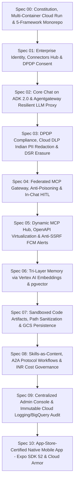

# Workkbot 2.0: Architecture & 10-Feature Specification Roadmap
## Sized for Indian SMBs (<100 Seats) Built & Deployed on Google Cloud (asia-south1) with Supabase, Google ADK 2.0, assistant-ui & Agentgateway

---

### Project Constitution (Spec-Driven Development)
Per the [spec-driven-development](file:///Users/sagarmeisheri/.gemini/config/skills/spec-driven-development/SKILL.md) framework, the project constitution defines the non-negotiables, technical blueprint, and living roadmap:
- **[constitution/mission.md](file:///Users/sagarmeisheri/Apps/workkbot/gemini-specs/constitution/mission.md)**: Vision, personas, product scope, and non-negotiable operational boundaries.
- **[constitution/techstack.md](file:///Users/sagarmeisheri/Apps/workkbot/gemini-specs/constitution/techstack.md)**: Single FastAPI backend on Google Cloud Run, Agentgateway 1.5.x, Google Vertex AI, Google Cloud Build, Supabase unified platform, and assistant-ui rules.
- **[constitution/roadmap.md](file:///Users/sagarmeisheri/Apps/workkbot/gemini-specs/constitution/roadmap.md)**: Living execution sequence with Gantt milestones for GCP deployment from Day 1.
- **[spec-live-integration-mandate.md](file:///Users/sagarmeisheri/Apps/workkbot/gemini-specs/spec-live-integration-mandate.md)**: Non-Negotiable Zero-Mock Law, live framework boundaries, and testing protocols.

---

### Executive Vision: The 5-Framework Canonical Pentagram
Workkbot 2.0 is an enterprise-grade AI assistant platform engineered specifically for organizations under 100 employees. Every architectural, product, and implementation decision must route through **5 core frameworks**:

1. **Supabase (Mumbai `ap-south-1`)**: The Unified Identity, Relational Storage (RLS), Hardware Vault (`pgsodium`), Vector Engine (`pgvector` HNSW `<=>`), and Realtime Data Backbone.
2. **Google Cloud Platform (GCP `asia-south1`)**: Multi-Container Serverless Compute (Cloud Run), Edge Security (Cloud Armor WAF), Statutory PII Sanitization (Cloud DLP), Secure Storage (GCS), Push Alerts (FCM), and Immutable Audit Sinks (BigQuery / Cloud Logging).
3. **Google ADK 2.0 (`google-adk`)**: Python Agentic Runtime, Multi-Turn Conversation Loops, Model Context Protocol Toolset (`McpToolset`), Session Services, and User-Centric In-Chat HITL Orchestrator (`ToolContext.request_confirmation()`).
4. **assistant-ui (`@assistant-ui/react`, `@assistant-ui/react-google-adk`, `@assistant-ui/react-native`)**: Declarative Chat Surface, Canonical UI Primitive Catalog, Streaming State Harness, Mobile Native Parity, Generative UI (`@assistant-ui/react-generative-ui`), and Observability (`@assistant-ui/react-o11y`).
5. **Agentgateway 1.5.x (Rust)**: High-Speed Agentic Data Plane, Dynamic MCP Tool Federation Engine, OpenAPI Virtualizer, Tool Poisoning & Shadowing Defense, CEL Policy Arbiter, Resilient LLM Router, and A2A Protocol Gateway.

---

### The North Star: Security & Mobile App Store Approval
Every spec, feature, and code change is anchored by two non-negotiables:

1. **Uncompromising Enterprise Security (Zero-Trust & Statutory DPDP Compliance)**:
   - **Database Isolation**: Every table carries `org_id` and is guarded by native PostgreSQL Row-Level Security (RLS) bound to `auth.uid()` and `auth.jwt() ->> 'org_id'`.
   - **Hardware Token Encryption**: All connected user MCP OAuth tokens are sealed in **Supabase Vault (`pgsodium`)**.
   - **Egress & SSRF Shielding**: Cloud Run Direct VPC Egress firewall rules unconditionally drop access to Link-Local Cloud Metadata (`169.254.169.254/32` and `metadata.google.internal`), completely eliminating SSRF credential harvesting.
   - **Tool Poisoning & Shadowing Defense**: Agentgateway sanitizes prompt injection markers from tool descriptions and blocks unauthorized tool registration or parameter tampering (mitigating CVE-2026-29791).
   - **Statutory Indian PII Protection**: Google Cloud Sensitive Data Protection (Cloud DLP) and fast-path Verhoeff regex scrub Aadhaar, PAN, and UPI data in `before_model` callbacks before prompts reach any LLM.
   - **Immutable Compliance Audit**: Structured audit logs stream to **Google BigQuery** in `asia-south1` with a 7-year retention lock satisfying India's DPDP Act 2023 and CERT-In directions.

2. **Guaranteed Mobile App Store Approval (Apple App Store & Google Play Policies)**:
   - **Apple Guideline 1.2 & 1.2.1 (AI UGC Moderation)**: Native `ActionBarPrimitive` incorporates an instant **[Report / Flag AI Output]** action on every message bubble.
   - **Apple Guideline 2.1 (App Completeness & Reviewer Sandbox)**: Dedicated demo credentials (`apple-reviewer@workkbot.in`) allowing instantaneous login into an isolated demo workspace with sandbox tools without corporate SSO/MFA blocking.
   - **Apple Guideline 2.5.2 (Execution of Code)**: Sandboxed `react-native-webview` with origin whitelisting (`artifacts.workkbot.in`) prevents untrusted script execution from touching native device code.
   - **Apple Guideline 3.1.3(c) (Enterprise Sign-In)**: Fully compliant enterprise B2B multi-tenant login without consumer in-app purchase gating.
   - **Apple Guideline 5.1.1 (Mandatory In-App Account & Memory Deletion)**: A prominent, one-tap in-app **"Delete Account & Purge Memory"** button in Settings invoking atomic Supabase RPC erasure without requiring external email or support.
   - **Apple Guideline 5.1.2(i) (Third-Party AI Disclosure & Consent)**: Pre-chat bilingual statutory consent outlining exact model data flows.
   - **Privacy Manifests**: Clean `PrivacyInfo.xcprivacy` with zero undeclared required-reason APIs.

---

### The 10-Feature Specification Ladder (The 5-Framework Architecture)

| Spec | Title | 5-Framework Routing Matrix | Security & Mobile Approval North Star |
|:---:|---|---|---|
| **[Spec 00](file:///Users/sagarmeisheri/Apps/workkbot/gemini-specs/spec-00-constitution-and-monorepo.md)** | **Constitution & Monorepo** | **Supabase**: Local/prod Postgres, RLS, Vault, Vector. **GCP**: Multi-container Cloud Run, Cloud Build, Artifact Registry, Cloud Armor. **ADK 2.0**: In-process Python Runner. **assistant-ui**: Canonical elements catalog scaffold. **Agentgateway**: Rust sidecar on `127.0.0.1:8080`. | VPC egress firewall blocks `169.254.169.254` (metadata SSRF immunity); Expo SDK 52 base setup. |
| **[Spec 01](file:///Users/sagarmeisheri/Apps/workkbot/gemini-specs/spec-01-auth-and-identity.md)** | **Auth, Identity & DPDP Consent** | **Supabase**: Google Workspace OAuth, Vault token encryption, RLS. **GCP**: Cloud Run backend, Cloud Armor WAF. **ADK 2.0**: Identity-bound sessions, in-stream auth challenges. **assistant-ui**: Sidebar auth footer (`-> Sign in`), Connectors Hub Modal (`[ Yours \| Discover ]`), composer `+` menu. **Agentgateway**: CEL-based per-session credential isolation. | Apple 2.1 Reviewer Sandbox (`apple-reviewer@workkbot.in`); Apple 5.1.1 in-app delete; Apple 5.1.2i bilingual DPDP consent. |
| **[Spec 02](file:///Users/sagarmeisheri/Apps/workkbot/gemini-specs/spec-02-core-chat-adk.md)** | **Core Chat on ADK 2.0 & Streaming** | **Supabase**: ADK sessions, event logs, `public.conversations` with RLS. **GCP**: Cloud Run HTTP/2 SSE streaming, Vertex AI Gemini 2.0 Flash/Pro. **ADK 2.0**: In-process Runner, `LlmAgent`, branching checkpoints. **assistant-ui**: `@assistant-ui/react-google-adk`, `BranchPickerPrimitive`, `Reasoning`, `ActionBarPrimitive`. **Agentgateway**: Loopback proxy (`:8080/v1`), circuit-breaking fallback. | Apple 1.2 mandatory Flag/Report AI Response action on every message bubble; sub-800ms TTFT. |
| **[Spec 03](file:///Users/sagarmeisheri/Apps/workkbot/gemini-specs/spec-03-dpdp-pii-and-erasure.md)** | **DPDP PII & DSR Erasure Engine** | **Supabase**: `execute_dsr_erasure()` RPC, `auth.admin.deleteUser()`, RLS. **GCP**: Cloud DLP API (Indian infoTypes: Aadhaar, PAN, GST) in Mumbai, Cloud Logging CERT-In sinks. **ADK 2.0**: `before_model` (PII tokenization), `before_tool` (rehydration), `after_tool` (masking). **assistant-ui**: Inline PII redaction badges, in-app Privacy Portal. **Agentgateway**: Parameter sanitization, CEL policy checks. | Zero-residual PII in LLM; Apple 5.1.1 complete in-app account & memory deletion in a single atomic transaction. |
| **[Spec 04](file:///Users/sagarmeisheri/Apps/workkbot/gemini-specs/spec-04-mcp-tools-and-hitl.md)** | **Dynamic MCP, Composio & In-Chat HITL** | **Supabase**: Vault (`pgsodium`) token encryption, `tool_invocations` RLS. **GCP**: Cloud Run loopback, Direct VPC Egress, Cloud Logging. **ADK 2.0**: `McpToolset`, heuristic safety classifier, `ToolContext.request_confirmation()`. **assistant-ui**: `useAdkToolConfirmations()`, inline `ApprovalCard`, `ToolGroup`, `ToolFallback`. **Agentgateway**: MCP tool federation, anti-poisoning, parameter sanitization (CVE-2026-29791). **Composio**: User session MCP endpoints, 1,000+ business toolkits. | In-chat self-approval without admin bottlenecks; touch-friendly mobile confirmation; zero plaintext tokens. |
| **[Spec 05](file:///Users/sagarmeisheri/Apps/workkbot/gemini-specs/spec-05-dynamic-mcp-hub.md)** | **Dynamic Connectors Hub & Generative UI** | **Supabase**: Supabase Vault, `user_notifications` with Realtime pub/sub. **GCP**: Firebase Cloud Messaging (FCM) mobile push, Cloud Run backend. **ADK 2.0**: `McpToolset` dynamic tool registry, generative UI data payloads. **assistant-ui**: Connectors Hub Modal (`[ Yours \| Discover ]`), Notification Drawer, `@assistant-ui/react-generative-ui`. **Agentgateway**: OpenAPI-to-MCP virtualization, anti-SSRF IP/DNS validator (CVE-2026-31943). **Composio**: Managed Connect Links, dynamic catalog (`toolkits.list()`), token revocation. | Deep anti-SSRF (blocking IPv4-mapped IPv6 `::ffff:169.254.169.254`); native FCM push bringing users directly to approval cards; Apple 5.1.1 token revocation. |
| **[Spec 06](file:///Users/sagarmeisheri/Apps/workkbot/gemini-specs/spec-06-tri-layer-memory.md)** | **Tri-Layer Memory System** | **Supabase**: Episodic (Postgres), Semantic (Supabase Vector with `pgvector` HNSW `<=>`), RLS, instant deletion RPC. **GCP**: Vertex AI `text-embedding-004` (768-dim in `asia-south1`), Cloud Run workers. **ADK 2.0**: Custom `BaseMemoryService`, `after_agent` async extraction, `before_model` bounded injection. **assistant-ui**: Suggestion chip ("What does AI remember about me?"), interactive memory panel. **Agentgateway**: Extraction proxy with prompt injection filtering. | Complete user transparency; Apple 5.1.1 and DPDP Sec 12 compliant instant in-app fact deletion. |
| **[Spec 07](file:///Users/sagarmeisheri/Apps/workkbot/gemini-specs/spec-07-sandboxed-artifacts.md)** | **Artifacts & GCS Persistence** | **Supabase**: `public.artifacts_metadata` table with RLS. **GCP**: Google Cloud Storage (GCS in Mumbai), V4 Signed URLs, isolated subdomain DNS (`artifacts.workkbot.in`). **ADK 2.0**: Artifact Service (E2B microVMs / Docker runner), `path_sanitizer.py`. **assistant-ui**: Split Canvas (`artifact-canvas.tsx`), `AssistantFrameProvider`, `CodeDiff`, header toggle `↗`. **Agentgateway**: CEL execution authorization, payload sanitization. | Complete path traversal immunity (CVE-2026-34371); Apple Guideline 2.5.2 compliance (sandboxed `react-native-webview`). |
| **[Spec 08](file:///Users/sagarmeisheri/Apps/workkbot/gemini-specs/spec-08-skills-workflows-governance.md)** | **Skills, Workflows & Governance** | **Supabase**: `public.agent_runs` telemetry with RLS for org admins. **GCP**: Google Cloud Monitoring (`token_cost_inr` custom metric), budget alerts. **ADK 2.0**: Content-as-data skills in `skills/`, `before_model` router (top 2), Progressive Workflow Ladder, `GovernancePlugin`. **assistant-ui**: Composer Skills menu (`+ -> Skills >`), slash commands (`/`), agent transfer status badges. **Agentgateway**: Agent-to-Agent (A2A) protocol proxy (`:8080/a2a`), CEL policy enforcement. | Bounded token consumption preventing runaway costs in INR; responsive, fluid multi-agent handoffs. |
| **[Spec 09](file:///Users/sagarmeisheri/Apps/workkbot/gemini-specs/spec-09-admin-console-and-audit.md)** | **Admin Console & Audit Engine** | **Supabase**: User roles in JWT, RLS policies, `public.org_provider_policies`. **GCP**: Cloud Logging sink to Google BigQuery in `asia-south1` (7-year lock). **ADK 2.0**: Structured execution telemetry via `GovernancePlugin`. **assistant-ui**: `@assistant-ui/react-o11y` trace waterfalls in web console, `@assistant-ui/react-ink` terminal CLI. **Agentgateway**: OTel security violation streams (`agentgateway.security.violation`), CEL sync. | Tamper-evident, 7-year immutable audit trail for DPDP & CERT-In; clear separation from end-user mobile interface. |
| **[Spec 10](file:///Users/sagarmeisheri/Apps/workkbot/gemini-specs/spec-10-mobile-expo-app-store-ready.md)** | **App-Store-Ready Mobile App** | **Supabase**: `@supabase/supabase-js` + `expo-secure-store`, biometric gate, `execute_dsr_erasure()`. **GCP**: Cloud Armor WAF rate-limiting, Cloud Run mobile SSE stream, Firebase Cloud Messaging (FCM). **ADK 2.0**: Lightweight mobile agent session streaming, tool confirmation states. **assistant-ui**: `@assistant-ui/react-native`, native primitives, `ActionBarPrimitive` with Flag action. **Agentgateway**: Mobile SSE multiplexing, CEL authorization, parameter sanitization. | **Guaranteed App Store Approval**: Apple Guidelines 1.2, 2.1, 2.5.2, 3.1.3c, 4.0, 5.1.1, 5.1.2i, and Google Play AI Safety Policy. |
| **[Spec UI](file:///Users/sagarmeisheri/Apps/workkbot/gemini-specs/spec-ui-canonical-workspace.md)** | **Canonical UI & Floating Composer** | **Supabase**: Auth state for profile/sidebar, employee greeting (`Back at it, [name]`). **GCP**: Vertex AI Google Search grounding (`Web search ✓`), GCS artifacts. **ADK 2.0**: Session event checkpoints, inline `ApprovalCard`, `Skills >` injection. **assistant-ui**: `ThreadListSidebar`, floating composer capsule, `[Chat \| Cowork]` mode toggle, 8-item `+` popover, `SuggestionPrimitive`. **Agentgateway**: Dynamic MCP tool registration (`Connectors >`), OpenAPI virtualizer (`Add plugins`). | Pixel-perfect implementation of canonical assistant-ui layout; Apple 1.2 flag on message bubbles; Apple 5.1.1 deletion in profile drawer. |

