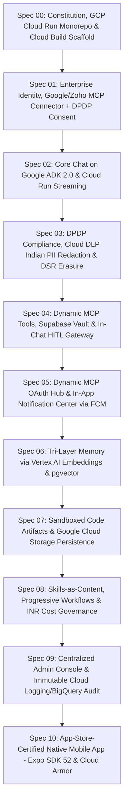

# Workkbot 2.0: Architecture & 10-Feature Specification Roadmap
## Sized for Indian SMBs (<100 Seats) Built & Deployed on Google Cloud (asia-south1) with Supabase & DPDP Compliance

---

### Project Constitution (Spec-Driven Development)
Per the [spec-driven-development](file:///Users/sagarmeisheri/.gemini/config/skills/spec-driven-development/SKILL.md) framework, the project constitution defines the non-negotiables, technical blueprint, and living roadmap:
- **[constitution/mission.md](file:///Users/sagarmeisheri/Apps/workkbot/gemini-specs/constitution/mission.md)**: Vision, personas, product scope, and non-negotiable operational boundaries.
- **[constitution/techstack.md](file:///Users/sagarmeisheri/Apps/workkbot/gemini-specs/constitution/techstack.md)**: Single FastAPI backend on Google Cloud Run, Google Vertex AI, Google Cloud Build, and Supabase unified platform rules.
- **[constitution/roadmap.md](file:///Users/sagarmeisheri/Apps/workkbot/gemini-specs/constitution/roadmap.md)**: Living execution sequence with Gantt milestones for GCP deployment from Day 1.

---

### Executive Vision & Day-1 Google Cloud Architectural Foundation
Workkbot 2.0 is an enterprise-grade AI assistant platform designed specifically for organizations of under 100 employees, with direct focus on Indian SMB workflows, statutory compliance with the **Digital Personal Data Protection Act (DPDP Act) 2023**, and **guaranteed mobile App Store approval** on iOS and Android.

#### Key Architectural Pillars (GCP Day 1):
1. **Google Cloud Serverless Compute Plane (asia-south1 / Mumbai)**:
   - **Google Cloud Run**: Runs the unified Python 3.12 FastAPI backend (hosting the Google ADK 2.0 Runner in-process) and Next.js 15 App Router SSR frontend with automated concurrency (`--concurrency=80`), zero cold-start (`--min-instances=1`), and native HTTP/2 SSE streaming.
   - **Google Cloud Build & Artifact Registry**: Automated CI/CD pipeline building, scanning, and deploying container images into `asia-south1-docker.pkg.dev` on every commit.
   - **Google Cloud Armor & Cloud Load Balancing**: DDoS protection, edge rate limiting, and managed SSL termination for production custom domains.
2. **Supabase as Unified Data & Security Backbone (Mumbai Region)**: Consolidates PostgreSQL 16+, GoTrue Auth, Row-Level Security (RLS), Supabase Vault (hardware token encryption via `pgsodium`), Supabase Vector (`pgvector` HNSW `<=>`), and Supabase Realtime (in-app alerts and HITL sync) into a single operational footprint.
3. **Google Vertex AI & Sensitive Data Protection (Cloud DLP)**:
   - **Gemini 2.0 Flash / Pro**: Primary agentic reasoning and Model Context Protocol (MCP) tool execution via Google ADK 2.0.
   - **Cloud DLP API + Fast-Path Regex**: Real-time Indian PII masking (Aadhaar, PAN, UPI, mobile) executed inside `before_model` callback before prompts reach the LLM.
4. **Google Cloud Storage (GCS) for Sandboxed Artifacts**: Secure bucket storage in `asia-south1` with V4 Signed URLs and Uniform Bucket-Level Access backing ADK's Artifact Service, rendered inside origin-isolated subdomains (`artifacts.workkbot.in`).
5. **Immutable Governance & Audit on GCP**:
   - Structured JSON audit logging to **Google Cloud Logging** and Cloud Trace.
   - Cloud Logging export sink streaming immutable records to **Google BigQuery** in `asia-south1` with a 7-year lock for DPDP compliance.
   - Real-time token usage converted into Indian Rupees (INR) and monitored via **Google Cloud Monitoring** custom metrics and alerts.
6. **In-App Focused Workspace & 100% User-Centric In-Chat HITL**: Mutating actions are automatically classified by the backend and confirmed **inline in the chat stream by the individual user** via `ToolContext.request_confirmation()`. In-app notification drawers (synced via Supabase Realtime) and mobile push alerts (Firebase Cloud Messaging) notify users when away from the thread. Zero admin approval bottlenecks.
7. **Mobile App Store Readiness**: Complete pre-compliance for Apple App Store (Guidelines 1.2, 2.1, 3.2.2, 4.0, 5.1.1) and Google Play AI Safety:
   - In-app "Flag/Report AI Response" on every chat bubble.
   - In-app "Delete Account & Purge Memory" flow via Supabase Auth and RPC.
   - Pre-configured Reviewer Sandbox credentials bypassing corporate MFA.

---

### The 10-Feature Specification Ladder (Day 1 on Google Cloud)

| Spec | Title | Focus & Core Delivery on Google Cloud |
|:---:|---|---|
| **[Spec 00](file:///Users/sagarmeisheri/Apps/workkbot/gemini-specs/spec-00-constitution-and-monorepo.md)** | **Constitution & Monorepo** | Mission boundaries, Turborepo + pnpm layout, Google Cloud Build pipeline, Artifact Registry, Cloud Run deployment in Mumbai (`asia-south1`). |
| **[Spec 01](file:///Users/sagarmeisheri/Apps/workkbot/gemini-specs/spec-01-auth-and-identity.md)** | **Auth, Identity & DPDP Consent** | Google Workspace OAuth, in-chat `+` tool connector for Google/Zoho MCPs, Supabase Vault token encryption, bilingual DPDP statutory consent. |
| **[Spec 02](file:///Users/sagarmeisheri/Apps/workkbot/gemini-specs/spec-02-core-chat-adk.md)** | **Core Chat on ADK 2.0** | Python ADK 2.0 Runner on Cloud Run, single `LlmAgent` using Vertex AI Gemini 2.0 Flash, HTTP/2 SSE streaming, message edit/branching. |
| **[Spec 03](file:///Users/sagarmeisheri/Apps/workkbot/gemini-specs/spec-03-dpdp-pii-and-erasure.md)** | **DPDP PII & Erasure Engine** | Google Cloud DLP (Sensitive Data Protection) + Regex fast-path for Indian PII (Aadhaar, PAN, UPI), cascading DSR Right to Erasure via Supabase RPC. |
| **[Spec 04](file:///Users/sagarmeisheri/Apps/workkbot/gemini-specs/spec-04-mcp-tools-and-hitl.md)** | **Dynamic MCP & In-Chat HITL** | Dynamic MCP tool discovery via OAuth, token encryption in Supabase Vault, automated safety classification, in-chat confirmation cards. |
| **[Spec 05](file:///Users/sagarmeisheri/Apps/workkbot/gemini-specs/spec-05-dynamic-mcp-hub.md)** | **Dynamic MCP Hub & Alerts** | In-app OAuth connection hub, schema caching, In-App Notification Center via Supabase Realtime + Firebase Cloud Messaging (FCM) mobile push. |
| **[Spec 06](file:///Users/sagarmeisheri/Apps/workkbot/gemini-specs/spec-06-tri-layer-memory.md)** | **Tri-Layer Memory System** | Episodic (Postgres), Semantic (Vertex AI `text-embedding-004` + `pgvector` HNSW `<=>`), Procedural (skills), "What AI Remembers" user panel. |
| **[Spec 07](file:///Users/sagarmeisheri/Apps/workkbot/gemini-specs/spec-07-sandboxed-artifacts.md)** | **Artifacts & GCS Persistence** | E2B microVMs + local Docker fallback, ADK Artifact Service backed by Google Cloud Storage (GCS) with V4 signed URLs, isolated subdomain iframe. |
| **[Spec 08](file:///Users/sagarmeisheri/Apps/workkbot/gemini-specs/spec-08-skills-workflows-governance.md)** | **Skills, Workflows & Governance** | Content-as-data skills, `before_model` router, ADK Coordinator/Sequential/Graph graduation, Cloud Monitoring custom metrics in INR. |
| **[Spec 09](file:///Users/sagarmeisheri/Apps/workkbot/gemini-specs/spec-09-admin-console-and-audit.md)** | **Admin Console & Audit Engine** | Org-wide provider allowlisting, user roles, token/rupee usage dashboards, immutable audit log streamed to Google BigQuery in Mumbai. |
| **[Spec 10](file:///Users/sagarmeisheri/Apps/workkbot/gemini-specs/spec-10-mobile-expo-app-store-ready.md)** | **App-Store-Ready Mobile App** | React Native Expo app with Cloud Armor rate-limiting, in-app Flag/Report UI, reviewer demo mode, in-app account deletion via Supabase Auth. |
