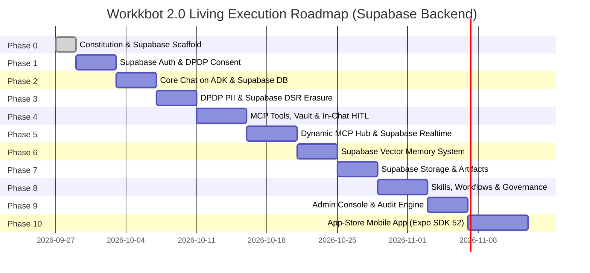

# Constitution: Living Execution Roadmap

## Phase 0: Foundations, Constitution & Supabase Scaffold
*Target Spec*: `gemini-specs/spec-00-constitution-and-monorepo.md`
- [x] Establish `constitution/mission.md` and define non-negotiables.
- [x] Establish `constitution/techstack.md` locking modern versions and Supabase platform unification.
- [x] Establish `constitution/roadmap.md` mapping the 10-feature spec ladder.
- [ ] Scaffold monorepo (`pnpm-workspace.yaml`, `turbo.json`), root `package.json`, and Supabase local environment (`npx supabase init`).

## Phase 1: Identity, Supabase Auth & DPDP Consent
*Target Spec*: `gemini-specs/spec-01-auth-and-identity.md`
- [ ] Supabase Auth integration: Google OAuth, Zoho OAuth, Enterprise SAML/OIDC SSO, domain-restricted Magic Links.
- [ ] Reviewer sandbox credentials bypassing corporate MFA for Apple/Google approval.
- [ ] DPDP statutory bilingual consent interstitial (English & Hindi) stored in Supabase with RLS.
- [ ] Supabase JWT verification and role claims (`member`, `tool-admin`, `org-admin`).

## Phase 2: Core Chat on Google ADK 2.0 & Supabase Postgres Sessions
*Target Spec*: `gemini-specs/spec-02-core-chat-adk.md`
- [ ] In-process ADK 2.0 Runner embedded in FastAPI backend.
- [ ] Single `LlmAgent` core conversational loop with pinned Gemini 2.0 Flash model tiering.
- [ ] Direct SSE streaming endpoint with token-by-token client rendering.
- [ ] ADK's `DatabaseSessionService` connected to Supabase PostgreSQL via SQLAlchemy/asyncpg.

## Phase 3: DPDP Compliance, Real-Time PII Masking & Supabase DSR Erasure
*Target Spec*: `gemini-specs/spec-03-dpdp-pii-and-erasure.md`
- [ ] Real-time Indian PII masking (Aadhaar, PAN, UPI, mobile) in ADK's `before_model` callback.
- [ ] Automated DSR erasure endpoint: cascades deletion across Supabase Auth (`deleteUser`), chat sessions, and vector memory.
- [ ] Audit trail pseudonymization for statutory compliance retention.

## Phase 4: Dynamic MCP Tools, Supabase Vault & In-Chat HITL
*Target Spec*: `gemini-specs/spec-04-mcp-tools-and-hitl.md`
- [ ] Dynamic MCP client connecting to Workkbot-managed MCP server URLs.
- [ ] Token Vault backed by **Supabase Vault (`pgsodium`)** for hardware-grade encryption of user OAuth tokens.
- [ ] Backend automatic classification of mutating/critical tools (verbs & schema heuristics).
- [ ] In-chat interactive confirmation card rendered for the active user via `ToolContext.request_confirmation()`.
- [ ] Immutable write-once `tool_invocations` audit log in Supabase Postgres.

## Phase 5: Dynamic MCP OAuth Hub & Supabase Realtime Notifications
*Target Spec*: `gemini-specs/spec-05-dynamic-mcp-hub.md`
- [ ] User-facing MCP connection manager: one-click OAuth authorization for standard providers.
- [ ] Dynamic tool discovery (`tools/list`) and schema caching.
- [ ] Central In-App Notification Center synced in real-time via **Supabase Realtime** (`postgres_changes`) + mobile push.

## Phase 6: Supabase Vector Tri-Layer Memory System & Transparency
*Target Spec*: `gemini-specs/spec-06-tri-layer-memory.md`
- [ ] Custom `BaseMemoryService` on **Supabase Vector (`pgvector`)** with HNSW cosine similarity search.
- [ ] Asynchronous background extraction via `after_agent` hook.
- [ ] Bounded top-K injection (max 400 tokens) via `before_model` hook.
- [ ] User-facing "What does AI remember about me?" transparency and self-deletion panel.

## Phase 7: Sandboxed Code Artifacts & Supabase Storage
*Target Spec*: `gemini-specs/spec-07-sandboxed-artifacts.md`
- [ ] E2B Firecracker microVM execution with local containerized Docker runner fallback.
- [ ] ADK Artifact Service backed by **Supabase Storage** with time-limited signed URLs (`createSignedUrl`).
- [ ] Isolated-origin rendering route on separate subdomain iframe with strict CSP and typed `postMessage`.
- [ ] Sandboxed mobile `WebView` component.

## Phase 8: Skills-as-Content, Progressive Workflows & Governance
*Target Spec*: `gemini-specs/spec-08-skills-workflows-governance.md`
- [ ] Markdown-based versioned skills in `skills/<name>/SKILL.md` with trigger manifests.
- [ ] Skill router callback injecting top-2 matching skills into context.
- [ ] Progressive workflow graduation: Single Agent → Coordinator Sub-Agent → Sequential Pipeline → Graph Workflow.
- [ ] Org-wide `GovernancePlugin` tracking token usage in Indian Rupees (INR) logged to Supabase.

## Phase 9: Centralized Admin Console & Immutable Audit Engine
*Target Spec*: `gemini-specs/spec-09-admin-console-and-audit.md`
- [ ] Admin console for user management and allowed MCP provider configuration governed by Supabase RLS.
- [ ] Token consumption and INR budget tracking dashboard with threshold alerts.
- [ ] Searchable and exportable audit trail viewer (`tool_invocations`) for statutory compliance reviews.

## Phase 10: App-Store-Certified Native Mobile App (Expo SDK 52+)
*Target Spec*: `gemini-specs/spec-10-mobile-expo-app-store-ready.md`
- [ ] Full chat and streaming parity in React Native Expo SDK 52+ using `@supabase/supabase-js`.
- [ ] Apple Guideline 1.2 / Google Play AI compliance: in-app "Flag/Report AI Response" on all bubbles.
- [ ] Apple Guideline 2.1: Built-in Reviewer Sandbox tenant bypassing MFA.
- [ ] Apple Guideline 5.1.1(v): In-app "Delete Account & Reset Memory" flow using Supabase Auth.
- [ ] Biometric unlock, offline SQLite cache, in-app notification drawer, and push notifications.
