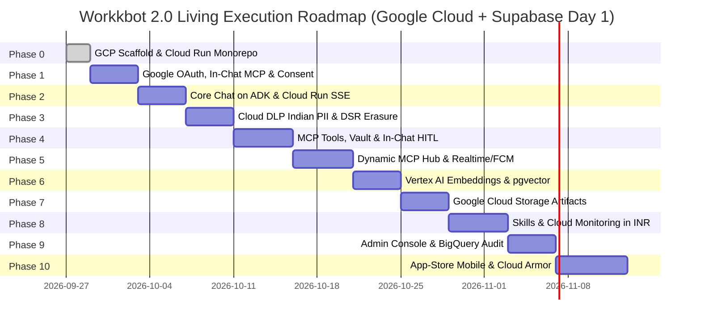

# Constitution: Living Execution Roadmap (Day 1 on Google Cloud)

## Phase 0: Foundations, Google Cloud Scaffold & Cloud Run Monorepo
*Target Spec*: `gemini-specs/spec-00-constitution-and-monorepo.md`
- [x] Establish `constitution/mission.md` locking Day-1 Google Cloud deployment in `asia-south1`.
- [x] Establish `constitution/techstack.md` locking Cloud Run, Agentgateway 1.5.x, Cloud Build, Vertex AI, and Supabase Mumbai.
- [x] Establish `constitution/roadmap.md` mapping the 10-feature spec ladder.
- [ ] Scaffold monorepo (`pnpm-workspace.yaml`, `turbo.json`), root `package.json`, and Supabase local environment (`npx supabase init`).
- [ ] Establish `infra/agentgateway/agentgateway.yaml` (MCP routes, LLM failover, CEL policies) and Terraform firewall rules blocking metadata egress (`169.254.169.254`).
- [ ] Establish `infra/gcp/cloudbuild.yaml` and Artifact Registry in `asia-south1`.
- [ ] Deploy initial Cloud Run multi-container baseline (FastAPI + Agentgateway sidecar) and `apps/web`.

## Phase 1: Identity, Google Workspace OAuth & DPDP Consent
*Target Spec*: `gemini-specs/spec-01-auth-and-identity.md`
- [ ] Single-click login via Google Workspace OAuth with minimal identity scopes.
- [ ] Interactive in-chat Plus (`+`) tool popover for on-demand Google Workspace and Zoho Workplace MCP OAuth.
- [ ] Token delegation from Supabase Vault to Agentgateway (`http://127.0.0.1:8080/mcp`) with per-session CEL isolation.
- [ ] Reviewer sandbox credentials bypassing corporate MFA for Apple/Google approval.
- [ ] DPDP statutory bilingual consent interstitial (English & Hindi) stored in Supabase with RLS.
- [ ] Supabase JWT verification and role claims (`member`, `tool-admin`, `org-admin`).

## Phase 2: Core Chat on Google ADK 2.0 & Cloud Run Streaming
*Target Spec*: `gemini-specs/spec-02-core-chat-adk.md`
- [ ] In-process ADK 2.0 Runner embedded in FastAPI backend on Cloud Run.
- [ ] Single `LlmAgent` core conversational loop routed through Agentgateway LLM proxy (`127.0.0.1:8080/v1`) with Vertex AI primary and automatic secondary failover.
- [ ] Direct HTTP/2 SSE streaming endpoint with token-by-token client rendering on Next.js 15.
- [ ] ADK's `DatabaseSessionService` connected to Supabase PostgreSQL in Mumbai.

## Phase 3: DPDP Compliance, Cloud DLP Indian PII Masking & DSR Erasure
*Target Spec*: `gemini-specs/spec-03-dpdp-pii-and-erasure.md`
- [ ] Google Cloud Sensitive Data Protection (DLP) + fast-path regex for Indian PII (Aadhaar, PAN, UPI).
- [ ] Presidio/DLP reversible in-session tokenization in ADK's `before_model` callback.
- [ ] Rehydrated tool dispatch through Agentgateway federated proxy with parameter sanitization.
- [ ] Automated DSR erasure endpoint: cascades deletion across Supabase Auth (`deleteUser`), chat sessions, and vector memory.
- [ ] CERT-In formatted security incident logging via Google Cloud Logging.

## Phase 4: Dynamic MCP Tools, Supabase Vault & In-Chat HITL
*Target Spec*: `gemini-specs/spec-04-mcp-tools-and-hitl.md`
- [ ] Agentgateway federated MCP client (`http://127.0.0.1:8080/mcp`) handling session fan-out and multiplexing.
- [ ] Token Vault backed by **Supabase Vault (`pgsodium`)** for hardware-grade encryption of user OAuth tokens.
- [ ] Gateway anti-poisoning, anti-shadowing, and parameter sanitization (mitigating CVE-2026-29791).
- [ ] Backend automatic classification of mutating/critical tools (verbs & schema heuristics).
- [ ] In-chat interactive confirmation card rendered for the active user via `ToolContext.request_confirmation()`.
- [ ] Immutable write-once `tool_invocations` audit log in Supabase Postgres and Cloud Logging.

## Phase 5: Dynamic MCP OAuth Hub & In-App Notification Center via FCM
*Target Spec*: `gemini-specs/spec-05-dynamic-mcp-hub.md`
- [ ] User-facing MCP connection manager: one-click OAuth authorization for standard providers.
- [ ] Agentgateway OpenAPI-to-MCP virtualization for Indian SMB ERPs/APIs (Tally, Zoho Books).
- [ ] Strict anti-SSRF validation rejecting DNS rebinding and IPv4-mapped IPv6 (mitigating CVE-2026-31943).
- [ ] Central In-App Notification Center synced in real-time via **Supabase Realtime** (`postgres_changes`) + Firebase Cloud Messaging (FCM) mobile push.

## Phase 6: Tri-Layer Memory via Vertex AI Embeddings & pgvector
*Target Spec*: `gemini-specs/spec-06-tri-layer-memory.md`
- [ ] Vertex AI Embeddings (`text-embedding-004`) generating 768-dimensional vectors.
- [ ] Custom `BaseMemoryService` on **Supabase Vector (`pgvector`)** with HNSW cosine similarity search.
- [ ] Asynchronous background extraction via `after_agent` hook.
- [ ] Bounded top-K injection (max 400 tokens) via `before_model` hook.
- [ ] User-facing "What does AI remember about me?" transparency and self-deletion panel.

## Phase 7: Sandboxed Code Artifacts & Google Cloud Storage
*Target Spec*: `gemini-specs/spec-07-sandboxed-artifacts.md`
- [ ] E2B Firecracker microVM execution with local containerized Docker runner fallback.
- [ ] Strict path traversal sanitization on artifact outputs (mitigating LibreChat CVE-2026-34371).
- [ ] ADK Artifact Service backed by **Google Cloud Storage (GCS)** in `asia-south1` with V4 signed URLs.
- [ ] Isolated-origin rendering route on separate subdomain iframe (`artifacts.workkbot.in`) with strict CSP.
- [ ] Sandboxed mobile `WebView` component.

## Phase 8: Skills-as-Content, Progressive Workflows & INR Cost Governance
*Target Spec*: `gemini-specs/spec-08-skills-workflows-governance.md`
- [ ] Markdown-based versioned skills in `skills/<name>/SKILL.md` with trigger manifests.
- [ ] Skill router callback injecting top-2 matching skills into context.
- [ ] Progressive workflow graduation: Single Agent → Coordinator Sub-Agent → Sequential Pipeline → Agent-to-Agent (A2A) Protocol via Agentgateway.
- [ ] Org-wide `GovernancePlugin` tracking token usage in Indian Rupees (INR) logged to Supabase and Google Cloud Monitoring.

## Phase 9: Centralized Admin Console & Immutable BigQuery Audit Engine
*Target Spec*: `gemini-specs/spec-09-admin-console-and-audit.md`
- [ ] Admin console for user management, allowed MCP provider configuration, and CEL policy sync.
- [ ] Agentgateway OpenTelemetry security log viewer (blocked prompt injections, SSRF probes).
- [ ] Token consumption and INR budget tracking dashboard with threshold alerts.
- [ ] Cloud Logging export sink streaming audit logs to **Google BigQuery** in `asia-south1` with 7-year retention.

## Phase 10: App-Store-Certified Native Mobile App & Google Cloud Armor
*Target Spec*: `gemini-specs/spec-10-mobile-expo-app-store-ready.md`
- [ ] React Native Expo SDK 52 mobile app communicating with Cloud Run backend via Cloud Armor WAF.
- [ ] In-app Flag/Report UI on every AI response bubble (Apple Guideline 1.2).
- [ ] In-app self-serve account and memory deletion (Apple Guideline 5.1.1).
- [ ] Pre-configured Reviewer credentials for one-click Apple App Review (Apple Guideline 2.1).
