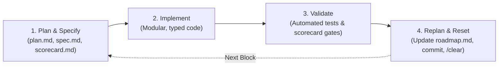

# Spec-Driven Development (SDD) & Agent Hygiene Protocols

## 1. Principles of Spec-Driven Development (SDD)
SDD decouples the **"What & Why"** (markdown blueprints in `specs/`) from the **"How"** (code implementation in `backend/`, `frontend/`, `infra/`).
- **Persistent Source of Truth**: The `specs/` directory is the single immutable reference across all agent conversations. When context windows reset, the agent re-anchors to `specs/constitution/` and `specs/features/`.
- **Triad Rule**: Every feature block must possess three files before code is authored:
  1. `plan.md`: High-level architecture, module interactions, dependency sequence.
  2. `spec.md`: Detailed functional contracts, data schemas, API contracts, error topologies.
  3. `scorecard.md`: Deterministic pass/fail criteria and verification instructions.

---

## 2. The 4-Step Execution Loop

### Step 1: Plan & Specify
- Review `specs/constitution/mission.md` and `specs/constitution/techstack.md`.
- Draft or verify the block triad (`plan.md`, `spec.md`, `scorecard.md`).
- Obtain user alignment on any open design questions.

### Step 2: Implement
- Write small, modular, typed files (`.py`, `.ts`, `.tsx`, `.sql`).
- Avoid bloated monolithic entry files.
- Ensure strict linting, type safety, and formatting compliance.

### Step 3: Validate
- Execute automated tests (e.g., `pytest`, RLS test scripts, bundle checkers).
- Check off every scorecard gate in the block's `scorecard.md`.
- No block is complete until all gates pass.

### Step 4: Replan & Reset
- Mark scorecard gates as checked in `specs/constitution/roadmap.md`.
- Ensure all artifacts are recorded.
- Prompt user for a clean git commit.
- Advise the user to execute `/clear` in the agent session to reset the context window before commencing the next block.

---

## 3. Context Window Hygiene & `/clear` Protocol
- LLM context windows suffer degradation as transcripts grow.
- At the end of every block:
  1. Summarize accomplishments in `walkthrough.md`.
  2. Update `roadmap.md` with checked gates.
  3. Verify that all knowledge required for the next block exists in `specs/`.
  4. Explicitly instruct the user to run `/clear`.

---

## 4. Invariant Engineering Rules
1. **Never Bypass Sovereignty**: Every connection endpoint must be strictly in Mumbai (`asia-south1`).
2. **Never Disable RLS**: Every table holding personal data must enable and force RLS and test tenant isolation (`user_id = current_setting('app.current_user_id', true)::uuid`).
3. **Never Log Sensitive PII**: PAN, Aadhaar, email, and phone numbers must be masked before leaving memory.
4. **Never Perform Destructive Writes Autonomously**: Inbound emails, calendar modifications, and data erasures require explicit confirmation.
5. **Non-Root Containers**: Docker builds must enforce non-root execution (`appuser`, UID 10001) on port 8080.
